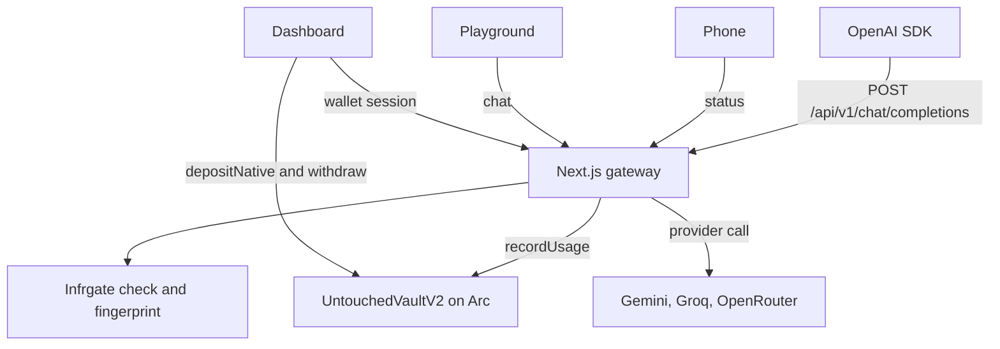

# Untouched

**Stake USDC once. The principal stays in the vault. Only the yield pays for AI.**

Untouched is an OpenAI-compatible API gateway on Arc Testnet. A deposit locks principal in `UntouchedVaultV2` and issues one `unt_live` key. Prompts spend a 14-day, 5% APY yield battery. A $50 stake adds about $0.0959. A call over the cap, or past the battery, is rejected and costs nothing.

The contract was compiled, tested, and deployed in Arc Studio. The app runs on Vercel. USDC on Arc is both the gas token and the deposit asset.

## Deployed

- App: https://untouchedd.vercel.app
- Dashboard: https://untouchedd.vercel.app/dashboard
- Playground: https://untouchedd.vercel.app/playground
- Phone: https://untouchedd.vercel.app/mobile
- Arc Studio: https://studio.arc.io/share/arc-vault-untouched-builder-hkpzoai6sc
- Source: https://github.com/Iam-jayant/untouched
- Live vault: [`0xcA9F8D931b6a0dE64ED74757A66aCB203413f2C1`](https://testnet.arcscan.app/address/0xcA9F8D931b6a0dE64ED74757A66aCB203413f2C1)

Point any OpenAI SDK at `https://untouchedd.vercel.app/api/v1`.

```bash
curl -X POST https://untouchedd.vercel.app/api/v1/chat/completions \
  -H "Authorization: Bearer unt_live_YOUR_KEY" \
  -H "Content-Type: application/json" \
  -d '{"model":"gemini-2.5-flash","messages":[{"role":"user","content":"Hello"}]}'
```

| Status | Meaning |
| --- | --- |
| 200 | Call completed and the yield battery was charged |
| 402 | The battery cannot cover the estimate |
| 403 | The estimate is over the per-call cap. Nothing was spent |
| 401 | Missing or unknown API key |
| 429 | More than 60 calls in a minute for that key |

## Features

- One stake, one key. Further deposits increase principal and battery. They do not mint another key.
- Principal and yield are separate. `withdraw` returns principal minus used yield and closes the position.
- Included models are Gemini 2.5 Flash, Llama 3.3 70B on Groq, and Qwen 2.5 and DeepSeek R1 on OpenRouter, at $1 per 1 million tokens. Untouched pays those providers. Claude and GPT stay locked.
- A successful call returns an x402 `PAYMENT-RESPONSE`. An empty battery returns `PAYMENT-REQUIRED`.
- The phone is the vault remote: stake, battery, usage, and withdraw.

### Infrgate

Rate limiting and idempotency come from [Infrgate](https://github.com/Iam-jayant/Infrgate), my open-source control plane for LLM gateways. The app uses the published package [`inference-by-infrgate`](https://www.npmjs.com/package/inference-by-infrgate).

On each chat call the gateway runs two commands from that SDK:

- `check` on `TokenBucketRateLimiter`, 60 requests per key per minute.
- `fingerprint` on `IdempotencyGuard`, a hash of the key, model, and messages. A repeat with the same `Idempotency-Key` is served from `get` and costs nothing. A new success is stored with `set`.

The playground shows that path as the execution trace: auth, rate limit, idempotency, policy, routing, finalize.

## Use cases

- Point Cursor, or any OpenAI SDK, at the gateway so an agent spends yield instead of the saved deposit.
- Give a coding agent a hard per-call cap. Over the cap, the request stops and the principal does not move.
- Stake from the phone, watch the battery, and withdraw the position without opening a chat.

## Architecture

The wallet stakes and withdraws on Arc. Every prompt goes through the gateway, which spends only the yield battery and calls the provider with Untouched's own key.



Arc Testnet is chain id `5042002`. RPC is `https://rpc.testnet.arc.network`.

| Contract | Address | Role |
| --- | --- | --- |
| UntouchedVaultV2 | `0xcA9F8D931b6a0dE64ED74757A66aCB203413f2C1` | Live app. Stakes, yield battery, and `recordUsage` |
| UntouchedVaultV2 | `0x494ef27eb33165407982ffc024c8d992f20dfa9f` | Arc Studio deployment. [Explorer](https://testnet.arcscan.app/address/0x494ef27eb33165407982ffc024c8d992f20dfa9f) |
| USDC | `0x3600000000000000000000000000000000000000` | Arc native gas token and ERC-20 precompile |

`depositNative()` stakes native USDC. `deposit(uint256)` stakes the 6-decimal ERC-20. One micro-USDC is `1e12` wei. The yield battery is `(amount * 500 * 14) / (10000 * 365)`. `recordUsage` cannot pass that quota. `withdraw` pays principal minus used yield.

Arc Studio compiled this vault, ran the 7 tests, and deployed the Studio copy. The live app uses the vault that already holds stakes. Studio is the authoring environment, not a hop in a request.
